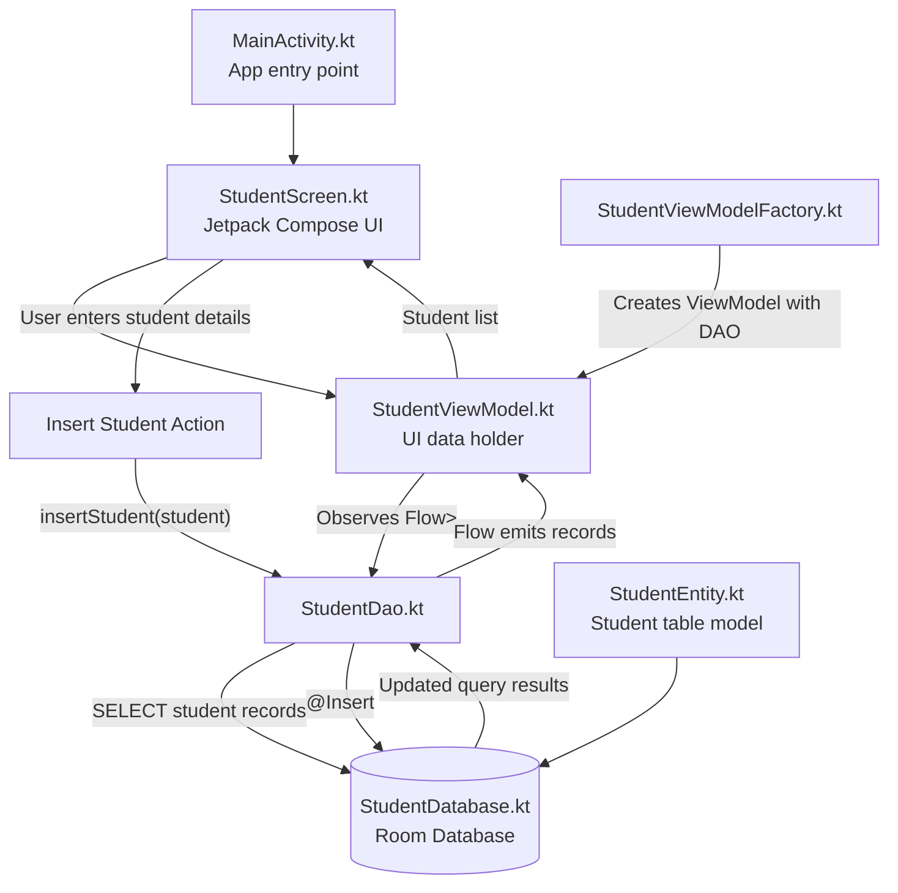

:: {align="center"}
# 🎓 Student Directory App

**A Local Student Record Management Android Application**

Built with **Kotlin · Jetpack Compose · Room Database · Kotlin Flow ·
MVVM**
:::📌 Project Overview
Student Directory App is an Android application designed to manage
student information in a simple and organized interface. It demonstrates
how student records can be entered, stored locally, and displayed in the
app using the Room persistence library.

The application interface includes a student-entry form and a
stored-records section. When the database has no records, the app
displays an empty-state message. When records are available, they are
displayed as individual student cards.
✨ Key Features
- Add Student Records -- Enter student details through the form.
- Local Data Storage -- Store records locally with Room Database.
- Student Directory -- Display saved student records in a list.
- Empty State -- Show a clear message when no student records are
  available.
- Record Information -- Present student details in readable cards.
- Compose UI -- Build the interface using Jetpack Compose
  components.
Displayed fields: The screenshots show Student Name, Roll Number,
and Course Code. The previously shared StudentEntity.kt model
contains id, name, and course. Ensure the current entity and
database schema include the roll-number field if it is intended to be
persisted.

🖼️ Application Screenshots
The screenshots below are displayed at a controlled width so they remain
readable without taking over the README page.
1. Home Screen -- Empty Student Directory
::: {align="center"}
``{=html}
:::What this screen shows: - The app title, Room DB: Student
Directory. - A form to enter student information. - A Save to Room
DB action. - A Stored Records section. - An empty-state
illustration and message when no records are stored.

How it works: The user enters the available student details and uses
the save action. When there are no saved records, the directory displays
the empty state instead of student cards.
2. Student Directory -- Stored Records
::: {align="center"}
``{=html}
:::What this screen shows: - A stored-records count. - Student cards
with names, roll numbers, and course codes. - A delete control on each
displayed record. - An add-student form below the list.

How it works: The directory presents the student records available
to the screen. The record cards make each student's information easy to
scan. The screenshot also shows a delete control; the exact delete
operation should be verified in the current DAO and UI implementation.
3. Student Entry -- Form with a Saved Record
::: {align="center"}
``{=html}
:::What this screen shows: - Student Name field. - Roll Number field. -
Course Code field. - Save to Room DB button. - Stored Student
Records section with a total count.

How it works: The user fills in the student details and taps the
save button. The app is designed to store the record locally and show
stored student information in the directory.
🧰 Technology Stack
  Technology                          Purpose
  Kotlin                          Main programming language

  Jetpack Compose                 Declarative UI for Android screens

  Room Database                   Local persistence layer

  Kotlin Flow                     Observable stream of database query
results

  AndroidX ViewModel              Holds and exposes UI-related data

  ViewModel Factory               Creates the ViewModel with its DAO
dependency
Coroutines                      Supports suspend database
operations
🏗️ Application Architecture
The project separates the UI, ViewModel, and database access
responsibilities.

🔄 How the Application Works
1. Application Launch: MainActivity.kt starts the app and hosts
   the Compose interface.
2. User Input: The user enters student information in the form.
3. Save Action: The UI passes the student data to the app's data
   layer.
4. DAO Operation: StudentDao.kt defines the database operations
   used to insert and retrieve student records.
5. Room Storage: StudentDatabase.kt provides the Room database
   and DAO.
6. Reactive Data: The DAO's getStudents() query returns a
   Flow<List<StudentEntity>>.
7. ViewModel: StudentViewModel.kt exposes that Flow to the UI
   layer.
8. Display: The UI displays the available student records, or an
   empty-state message when there are none.
🗂️ Project Structure
Main Kotlin package:
app/src/main/java/com/example/myapplicationint226/
  File                           Description
  MainActivity.kt              Main Android activity and Compose entry point
StudentEntity.kt             Defines the Room student table
StudentDao.kt                Declares student data operations
StudentDatabase.kt           Defines the Room database
StudentViewModel.kt          Exposes student data to the UI
StudentViewModelFactory.kt   Creates the ViewModel with the DAO
StudentScreen.kt             Displays the student directory UI
🧱 Database Model
The StudentEntity definition previously shared for this project
contains these fields:

  Field      Description
  id       Auto-generated primary key
name     Student name
course   Course name or code

The screenshots also show a Roll Number input and record label. Make
sure the current StudentEntity, DAO, and database version reflect that
field if it is stored by the app.
💻 Getting Started
Prerequisites
- Android Studio
- Android SDK compatible with the project's Gradle configuration
- Android Emulator or a physical Android device
Clone the Repository
git clone https://github.com/sachin-gautam-12/Student-Directory-App.git
Run the Application
1. Open the cloned folder in Android Studio.
2. Wait for Gradle sync to complete.
3. Choose an emulator or connect an Android device.
4. Click Run to build and launch the application.
🚀 Future Enhancements
- Add student details validation.
- Add edit and update functionality.
- Add student search and course filtering.
- Add confirmation before deleting a record.
- Add automated Room database and UI tests.
👨‍💻 Author
Sachin Gautam

Repository:
Student-Directory-App
::: {align="center"}
**Built with Kotlin and Jetpack Compose ❤️**
:::
