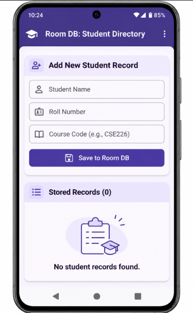
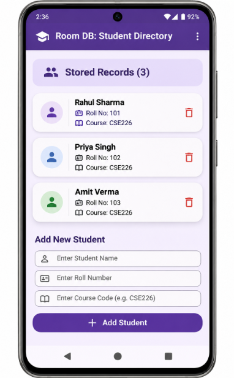
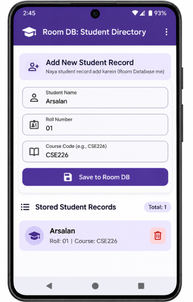
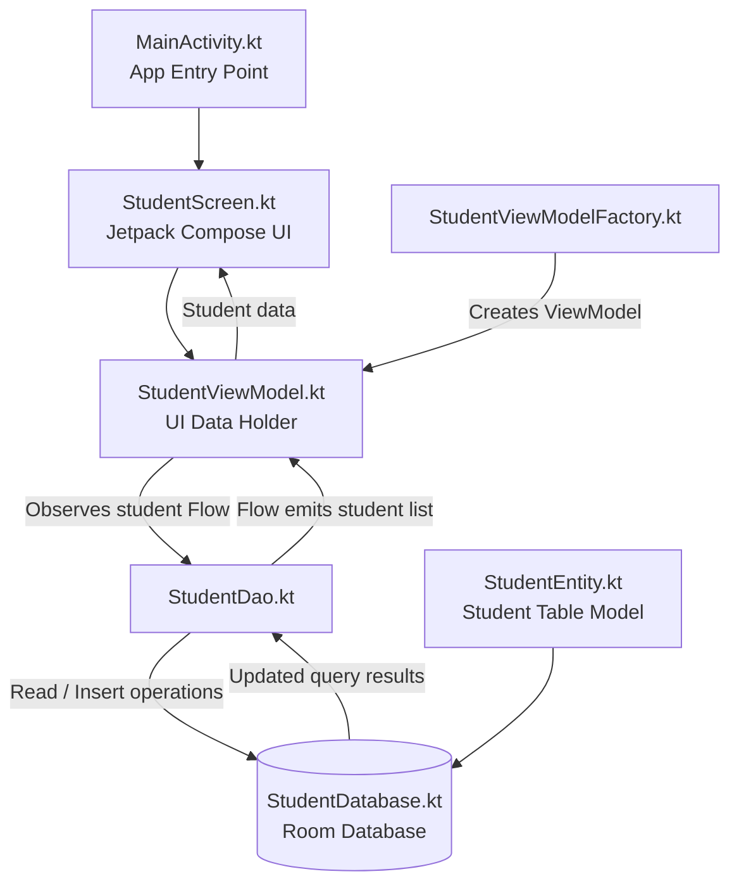

# 🎓 Student Directory App

### **A Local Student Record Management Android Application**

**Kotlin · Jetpack Compose · Room Database · Kotlin Flow · MVVM**

---

## 📌 **Project Overview**

**Student Directory App** is an Android application for managing student information through a simple, organized interface. It demonstrates how student records can be entered, stored locally, and displayed using the Room persistence library.

The app interface contains a student-entry form and a stored-records section. When no records are available, an empty-state message is displayed. When records are available, they appear as individual student cards.
✨ Key Features
- Add Student Records — Enter student details through the form.
- Local Data Storage — Store records locally using Room Database.
- Student Directory — Display available student records in a list.
- Empty State — Show a message when no records are available.
- Student Cards — Present student details in a readable format.
- Jetpack Compose UI — Build the interface with declarative Android UI components.
Data-model note: The screenshots show Student Name, Roll Number, and Course Code. The StudentEntity.kt definition previously shared contains id, name, and course. Make sure the current entity and database schema also include roll number if it is saved by the app.

🖼️ Application Screenshots
The screenshots are kept at a moderate width of 250 pixels so they remain clear without dominating the README.
1. Home Screen — Empty Student Directory

  

What this screen shows
- App title: Room DB: Student Directory
- Student details entry form.
- Save to Room DB button.
- Stored Records section.
- Empty-state illustration and message.
How it works

When there are no saved student records, the app displays an empty-state message. The user can enter student details in the form and use the save action to add a record.
2. Student Directory — Stored Records

  

What this screen shows
- Stored-records count.
- Student cards with names, roll numbers, and course codes.
- Delete controls on the displayed cards.
- Add New Student form.
How it works

The directory presents the student records available to the UI. Each card displays a student's information in a compact format. The screenshot includes delete controls; the exact delete behavior depends on the current DAO and UI implementation.
3. Student Entry — Form with a Saved Record

  

What this screen shows
- Student Name field.
- Roll Number field.
- Course Code field.
- Save to Room DB button.
- Stored Student Records section and total count.
How it works

The user enters the student information and taps the save button. The app is designed to store student data locally and display available records in the directory.
🧰 Technology Stack
Technology	Purpose
Kotlin	Main programming language
Jetpack Compose	Declarative Android UI
Room Database	Local database persistence
Kotlin Flow	Observable stream of database query results
AndroidX ViewModel	Holds and exposes UI-related data
ViewModel Factory	Creates the ViewModel with its DAO dependency
Kotlin Coroutines	Supports suspend database operations

🏗️ Application Architecture
The application separates UI presentation, ViewModel logic, and database access.

🔄 How the Application Works
1. Application Launch: MainActivity.kt starts the app and hosts the Compose interface.
2. User Input: The user enters student information in the form.
3. Save Action: The UI passes the entered information to the data layer.
4. DAO Layer: StudentDao.kt defines operations for inserting and retrieving student records.
5. Room Database: StudentDatabase.kt provides the Room database and DAO.
6. Reactive Data: getStudents() returns a Flow<List<StudentEntity>>, allowing the query results to be observed.
7. ViewModel: StudentViewModel.kt exposes the student Flow to the UI.
8. Display: The UI shows the available student records or an empty-state message when there are none.
🗂️ Project Structure
Main Kotlin package:
app/src/main/java/com/example/myapplicationint226/
File	Responsibility
MainActivity.kt	Android activity and Compose entry point
StudentEntity.kt	Defines the Room student table
StudentDao.kt	Declares student database operations
StudentDatabase.kt	Defines the Room database and DAO provider
StudentViewModel.kt	Exposes student data to the UI
StudentViewModelFactory.kt	Creates the ViewModel with its DAO dependency
StudentScreen.kt	Displays the student directory UI

🧱 Database Model
The previously shared StudentEntity.kt contains these fields:
Field	Description
id	Auto-generated primary key
name	Student name
course	Course name or code

Note: The screenshots also show a Roll Number field. Ensure the current StudentEntity, DAO, and database schema include that field if it is stored persistently.
💻 Getting Started
Prerequisites
- Android Studio
- Android SDK compatible with the project's Gradle configuration
- Android Emulator or a physical Android device
Clone the Repository
git clone https://github.com/sachin-gautam-12/Student-Directory-App.git
Run the Application
1. Open the cloned project in Android Studio.
2. Wait for Gradle sync to complete.
3. Select an Android emulator or connect a physical Android device.
4. Click Run to build and launch the application.
🚀 Future Enhancements
- Add validation for required student fields.
- Add student edit and update functionality.
- Add student search and course filtering.
- Add delete confirmation.
- Add automated database and UI tests.
👨‍💻 Author
Sachin Gautam

GitHub Repository: Student-Directory-App

Built with Kotlin and Jetpack Compose ❤️

